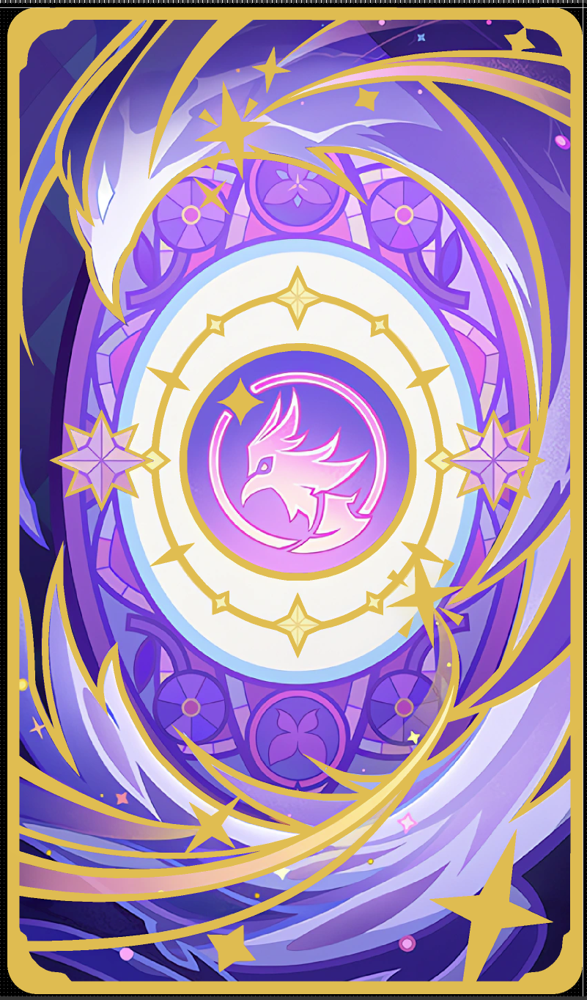
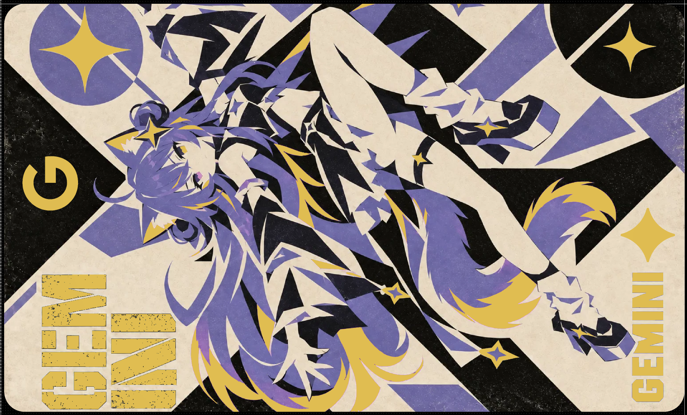

## [**Fischl**](Fischl) 2026-11-19

### [工程](Fischl/Fischl_2026-11-19.epro2) [Gerber](Fischl/Fischl_2026-11-19.zip)

## [**Gemini**](Gemini) 2026-11-08

### [工程](Gemini/Gemini_2026-11-08.epro2) [Gerber](Gemini/Gemini_2026-11-08.zip)

## [**Claude**](Claude) 2026-11-05

### [工程](Claude/Claude_2026-11-05.epro2) [Gerber](Claude/Claude_2026-11-05.zip)

## [**ChatGPT**](ChatGPT) 2026-11-01

### [工程](ChatGPT/GPT_2026-11-01.epro2) [Gerber](ChatGPT/GPT_2026-11-01.zip)

